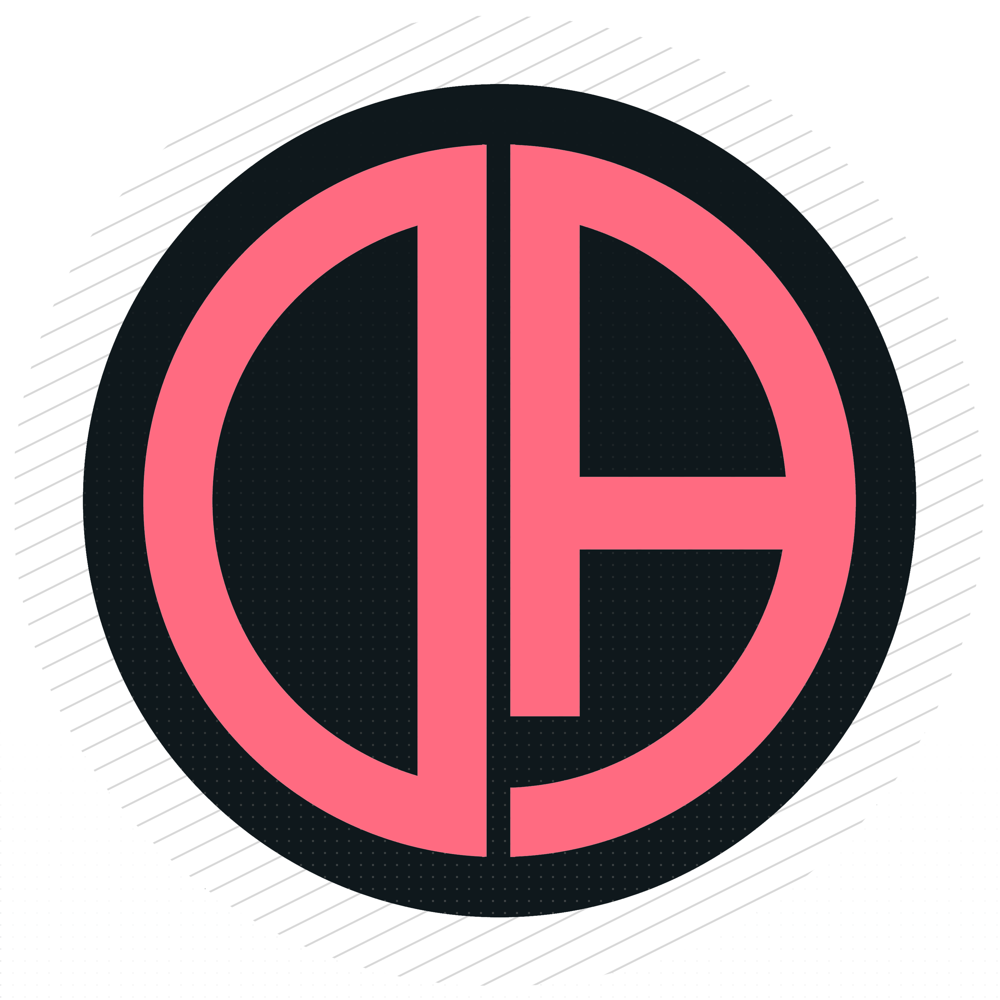

  
    
  
  
  
  
  
  
  

# Operation Autocraft

Operation Autocraft is a sophisticated automation overlay for Fallen Doll: Operation Lovecraft, designed to automatically interact with game features like distributing likes, handling hearts, and managing stamina bars.

This tool has been completely rewritten in **C++** using **DirectX 11** and **Dear ImGui**, providing a seamless, transparent, and ultra-fast in-game overlay without requiring the user to alt-tab or use separate command-line windows.

## Features

- **DirectX 11 ImGui Overlay**: Completely transparent, click-through overlay that seamlessly integrates with the game.
- **Dynamic Click-Through**: The overlay intelligently passes mouse clicks to the game while allowing you to interact with its own floating menus.
- **Auto-L (Hearts)**: Automatically presses the heart button when both male and female indicators turn yellow.
- **Auto-J (Bars)**: Automatically manages excitement bars.
- **Auto-Likes**: Intelligent liking system with two modes (Immediate and Accumulative) that scans the 10-segment gauge.
- **Interactive Calibration Wizard**: Set up click coordinates and color-detection zones directly on your screen.
- **Full Keybinding Customization**: Change any hotkey (keyboard and mouse buttons) directly from the GUI.
- **Bilingual Interface**: Support for English and Russian (RU) languages.

## Installation & Running

1. Download the latest compiled `Operation Autocraft.exe` from the releases page (or build it from source using CMake and Visual Studio).
2. Run the `.exe` file.
3. The transparent overlay will appear on your screen. 
4. Press **Insert** to toggle the menu visibility.

## Configuration & Calibration

Settings are saved automatically in `settings.json` after running the calibration wizard. 
To configure the bot for your specific resolution:
1. Open the **Settings** menu.
2. Click **START CALIBRATION**.
3. Follow the on-screen instructions, pressing the requested keys while hovering your mouse over the specific in-game UI elements.
4. Press **ESC** to exit calibration.

## License

This project is closed-source (Proprietary). Detailed terms of use can be found in the [LICENSE](./LICENSE) file.
